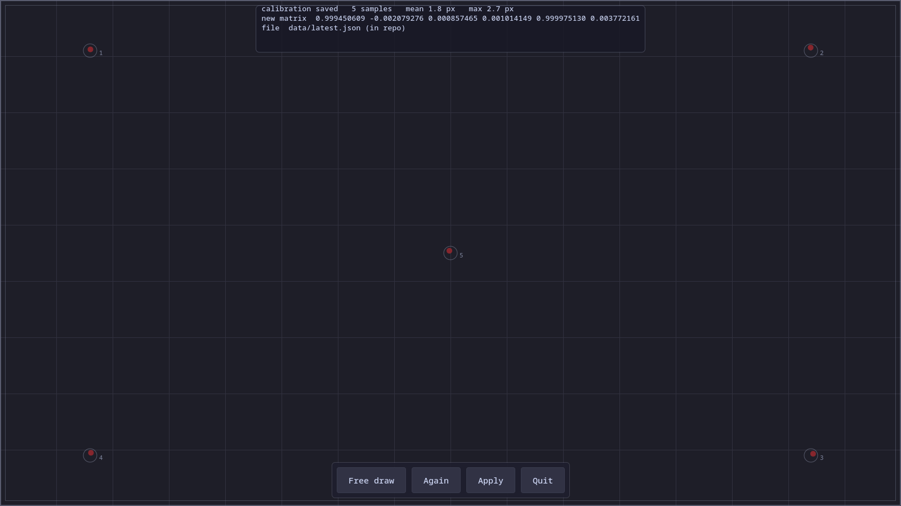

# Kalibret

<p align="center">
  
</p>

Simple GUI to set LIBINPUT_CALIBRATION_MATRIX.
Calibration value are saved as **udev rules** in the udev folder, you can apply it later yourself

## Features

- **Free draw mode**: draw anywhere on the panel to test touch responsiveness
- **5-point calibration**: tap 4 corners + center of screen to compute correction matrix
- **Real-time HUD**: shows coordinates, edge extents, and calibration status
- **Generate udev rules**: ready-to-copy file to `/etc/udev/rules.d/` in `udev/`
- **SSH access**: GUI appears on tablet LCD when run via SSH (with Wayland env)

## File structure

```
kalibret/
├── kalibret.py          # Main GUI (GTK3) + udev rules generator
├── kalibret.sh          # Shell wrapper (run from repo folder)
├── kalibret.conf          # CONFIG: DEVICE=/dev/input/eventX
├── udev/                  # Generated udev rules (created automatically)
│   └── 99-kalibret-touchscreen.rules
└── data/                  # Calibration backups
    ├── latest.json
    └── latest-matrix.txt
```

## Dependencies

### On Debian/Ubuntu

```bash
sudo apt update
sudo apt install -y \
    python3 \
    python3-gi \
    python3-cairo \
    udev \
    libinput-tools
```

### Device access (input group)

Make sure your account is member of the `input` group, then re-login.

```bash
sudo usermod -aG input $USER
```

## Usage steps

### 1. Find touchscreen device

```bash
libinput list-devices
ls /dev/input/event*
```

Look for a device with touchscreen name (e.g. `Goodix`, `ELAN`, `Synaptics`,
`Wacom`, `Touchscreen`). Note its path, example: `/dev/input/event5`.

### 2. Fill config

Edit `kalibret.conf` in the repo folder:

```
DEVICE=/dev/input/event5
NAME=Goodix Capacitive TouchScreen
TRANSFORM=0
```

Replace `/dev/input/event5` with the device path found in step 1.
Replace `Goodix Capacitive TouchScreen` with the actual device name from
`libinput list-devices`

Set `TRANSFORM` to your screen rotation:
- `0` = normal (default)
- `1` = 90 degrees clockwise
- `2` = 180 degrees
- `3` = 270 degrees clockwise
- `4` = flipped
- `5` = flipped-90
- `6` = flipped-180
- `7` = flipped-270

**How to test your transform value:**
1. Set `TRANSFORM=0` in `kalibret.conf`
2. Run `./kalibret.sh` and calibrate
3. If the calibration matrix is off by 90 degrees (touch coordinates appear rotated), try `TRANSFORM=1`, `3`, etc. until the touch points align correctly with the screen.
4. The calibration result screen shows mean/max error in pixels — lower is better.

### 3. Run kalibret

The GUI appears on your tablet's local LCD screen. Choose your display server:

#### Option A: Local terminal (directly on the tablet)

If you have direct access on the device (physical keyboard or on-screen keyboard), most environment variables are already set by your graphical session.

```bash
cd /path/to/kalibret

# Wayland
export GDK_BACKEND=wayland

# X11 (untested)
unset GDK_BACKEND

./kalibret.sh
```


#### Option B: Wayland (From remote device, tested on sway and KDE Plasma)

SSH to the tablet, set Wayland environment, then run:

```bash
ssh user@tablet-ip
cd /path/to/kalibret

export XDG_RUNTIME_DIR=/run/user/$(id -u)
export WAYLAND_DISPLAY=wayland-1   # or wayland-0, check with: ls /run/user/$(id -u)/wayland-*
export GDK_BACKEND=wayland

./kalibret.sh
```

#### Option C: X11 (From remote device, untested)

Just unset `GDK_BACKEND` and run:

```bash
ssh user@tablet-ip
cd /path/to/kalibret

unset GDK_BACKEND

./kalibret.sh
```

### 4. Calibrate

Tap 5 targets that appear on screen (4 corners + center). When done, the screen changes to **Result**.

To skip calibration and go straight to free draw mode, run with `--draw`:

```bash
./kalibret.sh --draw
```

### 5. Apply udev rules (manual, needs sudo)

After clicking Apply, the udev rules file is generated at:

```
udev/99-kalibret-touchscreen.rules
```

Copy to system and reload udev (or just reboot):

```bash
cd /path/to/kalibret
sudo cp udev/99-kalibret-touchscreen.rules /etc/udev/rules.d/
sudo udevadm control --reload-rules
sudo udevadm trigger --subsystem-match=input
```

### 6. Remove / Revert

To return to the original state:

```bash
sudo rm /etc/udev/rules.d/99-kalibret-touchscreen.rules
sudo udevadm control --reload-rules
sudo udevadm trigger --subsystem-match=input
```

Or click **Revert** in the GUI to remove the udev rules file from `udev/`.
